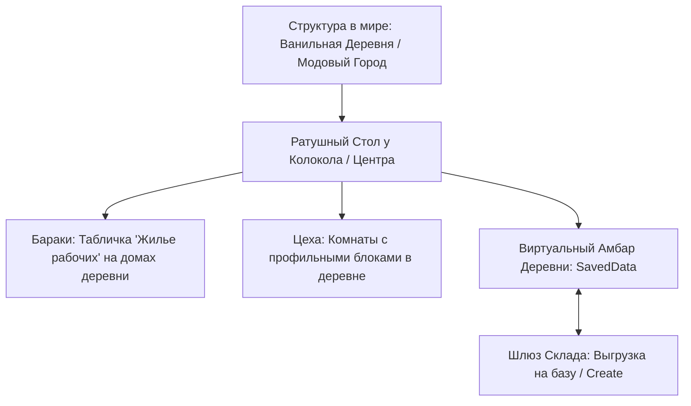
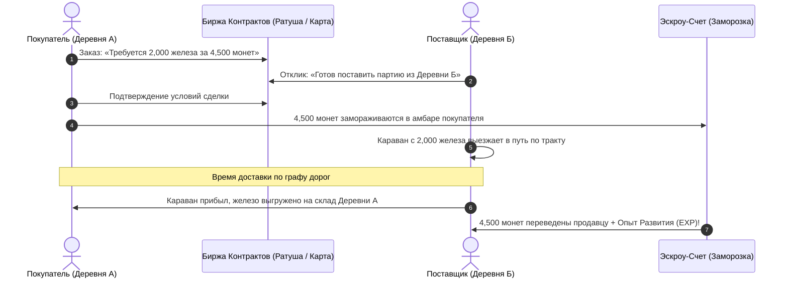

# Artisan's Delight: Полный дизайн-документ (GDD & Архитектура)

> **Концепция:** Органичная адаптация ремесленной и логистической системы в духе *Black Desert Online* под мир и философию *Minecraft*. Без корейского тайм-гейтинга, без кликанья по меню и без гринда — с осязаемыми физическими блоками в стиле *Farmer's Delight*, безопасной многопользовательской экономикой и умной ленивой симуляцией на базе современных компонентов (Minecraft 1.21.1+).

---

## 1. Философия и Манифест адаптации

Большинство модов на автоматизацию и ремесло впадают в две крайности: либо тяжелый индустриальный техно-моддинг (Create, GregTech), либо чисто декоративный контент без глубокой прогрессии. Успех *Farmer's Delight* показал: игроки обожают возиться с крафтом, когда он **осязаем, красив, полезен и логично вписан в выживание**.

### Ключевые столпы Artisan's Delight:

1. **Связность цепочек (Supply Chain):**
   * В ванильном Minecraft ресурсы изолированы (дерево нужно только для досок, коровы — ради кожи и стейков).
   * В *Artisan's Delight* ресурсы связываются в единую экосистему:
     * Рубка дерева дает брёвна, кору, сучья и *древесную смолу (живицу)*.
     * Разделка туш дает мясо, шкуры разного сорта и *животную кровь*.
     * Смола и кровь жизненно необходимы в алхимии; травы и мясо — в кулинарии; побочные продукты идут на удобрения, дубление кожи или торговый экспорт.
2. **Эксклюзивное сырье (Ответ ванильным фермам):**
   * Зачем отправлять рабочих, если в ваниле есть фермы железа и древесины?
   * Узлы добывают **уникальные, неавтоматизируемые ресурсы**: *живицу, кору редких деревьев, алхимическую кровь, горный сланец, мраморную крошку, трюфели и дикие пряности*. Без них невозможно продвинуться в высокой кулинарии, алхимии и королевских заказах.
3. **Ручной труд против Массового производства:**
   * **Ручное ремесло (Игрок):** готовка в котле и разделка ножом дает **высокий шанс проков** (до 35–50% на двойной выход или «Особое блюдо» с длительными мульти-баффами). Игрок готовит штучные шедевры.
   * **Мастерские (Рабочие):** производят стандартизированную продукцию без критов (1:1), закрывая потребность в массовом снабжении и экспорте.
4. **Отказ от ловушки «меню-кликера»:**
   * Вся первичная переработка вынесена в физический мир: сушильные рамы на солнце, ручные жернова, сито в проточной воде и разделочные столы.
5. **Динамические дорожные события (Node Incidents):**
   * Пока рабочие выполняют задачи, мир не стоит на месте: возможны нападения разбойников на караваны (требуется вмешательство игрока), поломки инструментов (доставка качественной кирки дает временный бафф +50% к добыче) или обнаружение богатых жил при высокой Удаче.

---

## 2. Физическое ремесло в мире (Hands-on Life Skills)

Вместо рецептов в верстаке 3х3 игрок взаимодействует с интерактивными рабочими станциями:

```
[Сырье в мире] ──> [Разделочный стол / Серп] ──> Мясо + Шкура + Кровь / Травы + Соки
[Полуфабрикаты] ──> [Сушилка / Жернова / Сито] ──> Вяленое мясо, Мука, Тонкая пряжа
[Готовка / Алхимия] ──> [Котел со слоями / Алхим-стол] ──> «Особые блюда» и Эликсиры
[Излишки] ──> [Упаковочный верстак] ──> Торговые ящики для Короны
```

### Основные профессии и механики:

| Профессия | Базовое сырье | Механика в физическом мире | Прок / Критический результат |
| :--- | :--- | :--- | :--- |
| **Сбор и Разделка** | Животные, дикоросы, деревья | **Разделочный стол с ножами**, сборники древесного сока, серпы травника | Шкуры высшего сорта, кровь для алхимии, редкие семена, почки деревьев, древесная смола |
| **Обработка (Processing)** | Зерно, сырые шкуры, мясо, минералы | **Сушильные рамы** (на солнце / над костром), **Ручные жернова**, **Сито в воде**, бочки брожения | Мука тонкого помола, дубленая кожа, концентрированная очищенная вода, золотые самородки |
| **Кулинария (Cooking)** | Овощи, мясо, специи, полуфабрикаты | **Котел со слоями ингредиентов** и регулировкой силы огня | Двойной выход порций, шанс сварить **«Особое блюдо»** с длительными мульти-баффами |
| **Алхимия (Alchemy)** | Кровь, соки, порошки, дикие грибы | **Алхимический дистиллятор** с контролем температуры колбы | Редкие эликсиры (скорость атаки, сбор, стабильное ночное зрение без мерцания) |
| **Торговля (Trading)** | Излишки ремесленной продукции | **Упаковочный верстак** (создание стандартизированных ящиков и тюков) | Сдача по Королевским заказам за золотые марки и уникальные чертежи |

### Прогрессия мастерства:
4 понятных тира: **Новичок $\rightarrow$ Ученик $\rightarrow$ Профессионал $\rightarrow$ Мастер**.
* Повышение тира снижает износ инструментов, открывает сложные рецепты и повышает шанс проков.
* Рост тира привязан к выполнению ремесленных вех (например, *«Приготовить 5 разных видов сложных супов»*, *«Выдубить 10 шкур разного зверя»*), а не к тупому счетчику тысяч кликов.
* Специализированная экипировка в слоты Curios: *Фартук шеф-повара*, *Перчатки травника*, *Пояс лесоруба*.

---

## 3. Грамоты Развития (Charter Points / Очки Влияния)

**Грамоты Развития (ОР)** — официальные лицензии Торговой Гильдии на освоение территорий, активацию узлов и открытие мастерских.

### Шкала Опыта Развития (Influence EXP):
Очки не выдаются поштучно за клики — их пул зарабатывается через постоянный вклад игрока в развитие мира:

```
[Задания и заказы деревень] ──┐
                              ├──> [Шкала Опыта Развития] ──> Каждые 1000 EXP = +1 Грамота Развития (ОР)
[Имперская / Королевская торговля] ─┘
```

1. **Источники Опыта Развития:**
   * **Королевская / Имперская Торговля:** Сдача торговых ящиков снабжает регион дефицитным сырьем. Каждая поставка приносит как монеты, так и весомый приток *Опыта Развития*. Чем дальше и сложнее маршрут доставки ящика, тем больше EXP получает игрок.
   * **Поручения и задачи деревень:** Помощь жителям, ликвидация разбойничьих аванпостов (+EXP) и закрытие кризисных запросов ратуши.
2. **Прогрессия:**
   * Каждые 1000 EXP (значение настраивается в конфиге) перманентно увеличивают общий пул доступных игроку Грамот Развития на **+1 ОР**.
3. **Правила инвестиций и баланс:**
   * ОР инвестируются в узлы и мастерские. Их можно вернуть обратно в общий пул, но с защитой от мгновенных манипуляций: отзыв ОР возможен **только после завершения текущего цикла рабочего** и накладывает **период деактивации узла (1 игровой день)**.

---

## 4. Деревни-Хабы: Органичная интеграция в мир (Без MineColonies)

> **Принцип:** Никакого строительства городов с нуля и возни со строительными лесами в стиле *MineColonies* или *Millenaire*. Игрок исследует мир и осваивает **уже существующие в генерации деревни и поселения**!



### 1. Поддержка любых структур через Конфиг и Датапаки:
* Городом-хабом может стать любая структура, прописанная в теге датапака `#artisansdelight:town_structures` или в конфигурационном файле мода.
* **По умолчанию поддерживаются:**
  * Все ванильные деревни (`minecraft:village_plains`, `village_taiga`, `village_desert`, `village_savanna`, `village_snowy`).
  * Полная совместимость с модами на генерацию городов (*ChoiceTheorem's Overhauled Village*, *Towns and Towers*, *Repurposed Structures* и др.) — достаточно указать ID структуры в конфиге.

### 2. Как активируется и функционирует Город-Хаб:
* **Ратушный Стол Старосты (Town Hall Core):**
  * Генерируется в центре поселения (рядом с деревенским колоколом или на месте стола картографа).
  * Игрок взаимодействует со столом, вносит Грамоты Развития (ОР) и официально открывает в этой деревне представительство своей торговой сети.
* **Бараки (Жилье рабочих):**
  * Игрок не строит новые дома — он осваивает жилой фонд деревни.
  * Достаточно повесить на дверь свободного дома жителей вывеску/табличку *«Жилье наемников»*.
  * Кровати внутри этого дома (нативно считываемые через `PoiManager`) дают слоты найма рабочих для этой деревни.
* **Мастерские и Цеха:**
  * Комнаты с установленными рабочими станциями внутри радиуса деревни:
    * *Плавильня / Литейная:* автоматическая переплавка руды силами наемников.
    * *Столярный цех:* производство ящиков, каркасов повозок и мебели.
    * *Паковня (Упаковочная):* фасовка ресурсов склада в торговые ящики для Короны.
* **Виртуальный Амбар Деревни (SavedData):**
  * Изолированное хранилище ресурсов поселения. Привязано к `OwnerId` (игрок или артель).
  * **Конечная вместимость и защита от раздувания:** Склад строго ограничен (базовые 24 слота). Расширяется назначением зданий склада, но имеет фиксированный потолок.
  * **Остановка при переполнении (Storage Full):** Если амбар забит, рабочий завершает текущий цикл, переходит в статус `STORAGE_FULL` и **полностью прекращает работу**. Чтобы рабочий продолжил трудиться, игрок должен освободить место и нажать кнопку *«Возобновить / Повторить работу»*.
* **Шлюз Склада (Warehouse Terminal):**
  * Физический блок-экспортер. Игрок может поставить его в самой деревне или забрать на свою загородную базу/усадьбу, подключив трубы или воронки *Create* для автоматической выкачки ресурсов из виртуального амбара.

### 3. Выкуп Хартии Деревни и Статус Губернатора (Town Lord):
Игрок или артель могут выкупить **Хартию Поселения (Town Charter)** за Грамоты Развития (ОР), став официальным «Лордом / Мэром» города:
* **Динамическая стоимость:** Базовая пустая деревня на старте стоит 4 ОР. По мере роста деревни (количества открытых цехов, привязанных узлов и торгового оборота) стоимость Хартии возрастает (до 15–30 ОР).
* **Привилегии Губернатора:**
  1. **Городской налог (Пошлина):** Любой другой игрок или NPC может продолжать пользоваться деревней, но **5–10% от всех торговых сделок, аренды бараков и выплавки руды автоматически отчисляется в казну владельца Хартии**!
  2. **Городские Указы (Town Ordinances):** Владелец активирует глобальные баффы для региона:
     * *«Горный устав»* (+20% к добыче руды на привязанных шахтах).
     * *«Сельская ярмарка»* (приток редких странствующих купцов с экзотическими семенами).
     * *«Дорожное ополчение»* (увеличение скорости повозок и защита от задержек).
  3. **Королевские Мануфактуры (Tier 3):** Только губернатор может возводить элитные цеха высшего тира (Королевскую Литейную, Ювелирный двор). Другие игроки могут лишь арендовать их мощности у владельца.
* **Защита от «игры в шашки» (Анти-монополия):**
  * Покупка деревни **не блокирует** других игроков намертво. Новички всё ещё могут брать контракты и нанимать базовых рабочих, но владелец получает с них стабильную пассивную ренту.

### 4. Собственный генератор трактов и Граф Дорог (Terrain-Aware Road Generator):
Вместо кривых ванильных путей или модов, строящих дороги вертикально в скалы (как *Settlement Roads*), в мод закладывается собственный 3D-трассировщик трактов:
* **Учет рельефа (Terrain-Aware Pathfinding):** Алгоритм прокладывает дороги вдоль изолиний высот, огибает отвесные скалы, делает пологие серпантины и аккуратные каменные ступени.
* **Сохранение графа дорог (`TownRoadGraph`):** Траектории трактов сохраняются в данных мира как список соединенных сегментов.
* **Фундамент на будущее:** Сохраненный граф служит не только для расчета честного времени в пути караванов, но и является прямой базой для спавна реальных физических сущностей-караванов, шагающих по дорогам между городами.

### 5. Виртуальная изоляция поселения:
Вся экономика, рабочие и амбар существуют как виртуальная модель данных (`SavedData`). Ванильные зомби-апокалипсисы, гибель жителей или случайный рейд разбойников не ломают производственную машину и не стирают имущество игрока.

---

## 5. Производственные Аванпосты и Боевые Инциденты

Между поселениями процедурно генерируются природные аванпосты:
* *Заброшенная каменоломня в горах* (песок, сланец, гравий, глина, драгоценная крошка).
* *Лесопилка у реки* (брёвна биома, кора, древесная смола/живица).
* *Старая рудная шахта* (сырое железо, медь, уголь, редкие минералы).
* *Лесная пасека / Виноградник* (мёд, дикие ягоды, травы, грибницы, трюфели).
* *Рыбацкий причал на побережье* (рыба, раковины наутилуса, морские губки).

### Механика освобождения: Боевой Триггер (Вместо хрупкого фазинга)
Отказ от пакетной подмены блоков гарантирует стабильность физики мира, освещения и совместимость с модами:
1. **Единый физический мир:** Аванпост существует в мире как монолитная структура с неразрушимым **Межевым Столбом (Node Milestone)**.
2. **Логический статус для каждого OwnerId (`KnotPhaseState`):**
   * `LOCKED` $\rightarrow$ `CLEARED` $\rightarrow$ `ACTIVE`.
3. **Боевой вызов (Encounter Trigger):**
   * При приближении игрока/команды со статусом `LOCKED` Межевой Столб активирует боевой инцидент (спавнит именную группу мобов/разбойников).
   * Защита периметра от гриферства обеспечивается отменой событий `BlockEvent.BreakEvent` в радиусе аванпоста до его освобождения.
4. **Восстановление и пуск:**
   * После победы над мобами игрок сдает на Межевой Столб ремонтный пакет ресурсов (доски, факелы, камень).
   * Узел переходит в статус `ACTIVE`: на объекте зажигаются фонари, а клиент начинает отображать атмосферных анимированных рабочих за верстаками.
5. **Узлы добывают исключительно сырьё!** Никаких готовых досок или слитков — только первичные материалы.
6. **Межпространственная логистика (Nether & End):**
   * Для подключения узлов из других измерений (кварцевые жилы, лавовый базальт, сады хоруса) игрок обязан активировать **Портальные Заставы (Portal Gate Depots)** по обе стороны портала (в Обычном мире и в Незере/Энде).
   * Каждая портальная застава требует инвестиции Грамот Развития (ОР). Это создает естественный баланс и делает доступ к адским/эндер-ресурсам дорогой стратегической инвестицией.

---

## 6. Рабочие: Специализация, Жизненный Цикл и Биржа

### 1. Расы и Аффинитет (Жесткая специализация):
Вместо выбора «лучшего по цифрам» каждая раса незаменима в своей нише:

| Раса / Архетип | Сильные стороны | Слабые стороны | Аффинитет к узлам |
| :--- | :--- | :--- | :--- |
| **Разбойник (Илладжер-изгой)** | Сверхбыстрый бег и скорость цикла. | Низкий запас сил (10–14 SP). | **+35% к выработке на каменоломнях и шахтах.** Не способен собирать травы и плоды. |
| **Житель (Сельский мастер)** | Надежный универсал, большой запас сил (25–35 SP). | Средняя скорость. | **+30% к фермам, пасекам и столярным мастерским.** Штраф к глубоким рудникам. |
| **Ведьма (Мистик-травница)** | **Максимальная Удача.** Шанс редких катализаторов. | Умеренная скорость и запас сил (15–20 SP). | **Эксклюзивный сбор смолы, редких трав, трюфелей и крови.** Бесполезна на карьере. |
| **Голем (Тяжеловес)** | Колоссальный выход руды, огромный запас сил (45–55 SP). | Крайне медлителен. Не ест еду (требует уголь/железо). | **Глубокие металлургические шахты.** |

### 2. Жизненный цикл рабочих (Бессмертие и Биржа):
* **Рабочие не умирают:** При падении энергии до 0 SP рабочий впадает в сон (`IDLE_NO_ENERGY`) и терпеливо ждет еды на складе.
* **Запрет на удаление «в никуда»:** Нанятого рабочего нельзя просто стереть из мира или выкинуть. У игрока есть два пути:
  * Либо продолжать прокачивать наемника и отправлять на подходящие узлы.
  * Либо выставить контракт рабочего на **Биржу Наемников (Worker Auction)** в Ратуше за монеты (где его могут перекупить другие игроки или с выкупом заберет Торговая Гильдия).
* **Продвинутый навык «Транзитная логистика» (Сброс в другой город):**
  * По умолчанию рабочий возвращается строго в амбар своего домашнего города.
  * Наемник, открывший перк *«Дальнобойщик / Логист»*, получает способность доставлять добытое сырье напрямую в амбар **любого другого связанного поселения** сети (время доставки увеличивается пропорционально расстоянию).

### 3. Кулинария как главное топливо экономики (Синергия с FD):
Рабочий расходует 1 очко бодрости (SP) за цикл. Провизия сгружается в Амбар поселения:
* **Базовый паёк (Хлеб, картофель):** +1–2 SP.
* **Сытный перекус (Сэндвичи, пироги):** +4–6 SP.
* **Шедевры Farmer's Delight (Пастуший пирог, Рагу в тыкве):** восстанавливают шкалу целиком + дают бафф морали (**+15% к скорости и +5 к Удаче** на следующие 20 циклов).

### 4. Условия найма (Отказ от обесцененных изумрудов):
Чтобы нанять рабочего высокого ранга, требуется:
1. **Репутация поселения** (заработанная выполнением заказов).
2. **«Кулинарный аванс»:** наемник требует конкретное сытное блюдо для подписания контракта (например, мастер-разбойник требует *Говяжье жаркое с грибами*).
3. **Регулярное жалованье (Currency Sink):** периодическая плата монетами за продление контракта рабочего.

---

## 7. Торговля, Динамический Рынок и RTS-Экономика (Commerce)

Торговля в моде решает две задачи: вывод излишков ресурсов из мира и заработок **Опыта Развития** для расширения империи.

### 1. Производство Торговых Ящиков (Trade Crates):
В городских паковнях сырье и полуфабрикаты прессуются в стандартизированные ящики (по 16–64 ед. сырья на ящик):
* *Ящики минералов:* медь, железо, золото, редкие сплавы.
* *Ящики пиломатериалов:* дубовая фанера, сосновый брус, березовые плашки.
* *Продовольственные контейнеры:* консервы, вяленое мясо, сыры, тюки сушеных трав.

---

### 2. Динамический Рынок: Закон Спроса и Предложения (Анти-монополия):
В игре действует живая рыночная модель. Игрок не может бесконечно сдавать один лишь «Ящик картофеля» или «Ящик железных слитков»:
* **Обвал цен от перенасыщения:** Чем больше ящиков одного типа сдается на рынок, тем сильнее падает рыночный спрос на этот товар (вплоть до 40–60% от номинала).
* **Мотивация к диверсификации:** Чтобы максимизировать прибыль и приток Опыта Развития, игрок обязан развивать **разностороннюю экономику**: чередовать поставки древесины, текстиля, редких металлов, кулинарии и алхимии.

---

### 3. RTS-подход: Живой симулятор экономики поселений (NPC Autonomous Market):
Мир не статичен. Деревни и города в генерации живут собственной экономической жизнью:
* **Автономное производство и сброс ресурсов:**
  * *Горные поселения* добывают руду и камень, регулярно сбрасывая их на рынок (что снижает мировую цену на металлы), но испытывают дефицит еды и досок (что взвинчивает цены на них).
  * *Сельскохозяйственные равнинные деревни* производят избыток зерна и шерсти, но остро нуждаются в металле и стройматериалах.
* **Автоматическое потребление (Отскок цен):**
  * Поселения и бродячие караваны со временем «выкупают» и потребляют накопившиеся на рынке дешевые товары. Это гарантирует, что обваленная игроком цена не зависнет на дне навсегда, а естественно восстановится через время.
* **Мультиплеерное взаимодействие:** На серверах рынок общий для всех игроков и артелей. Игроки могут мониторить дефицит в регионах и закрывать чужие просадки спроса.

---

### 4. Формула прибыли и Бонус расстояния по Графу:
$$\text{Итоговая Цена} = \text{Базовая Цена} \times \left(1 + \min\left(\text{PriceCap}, \frac{\text{Длина пути по графу}}{100} \times 0.05\right)\right) \times \text{Коэффициент Спроса (40\%–160\%)}$$

* **Путь по графу Дейкстры:** Расстояние считается строго по связанным дорогам и узлам сети, делая прокладку трактов стратегической задачей.
* **Настраиваемый кап расстояния:** В конфиге можно выставить максимальный потолок бонуса (по умолчанию +100%) или **полностью отключить кап**, если сборка поощряет дальние путешествия на тысячи блоков.

---

### 5. Королевский Заказ и Печати Ремесленника:
* Государственные тендеры от Короны на закупку дефицитных партий по повышенной ставке (**200–250% от номинала**).
* Награда: чистая монета, крупный бонус **Опыта Развития** и **«Золотые марки ремесленника»** для покупки уникальных чертежей повозок, лицензий и инструментов.

---

### 6. Гибкая настройка через Конфиг и Датапаки (Data-driven):
Все параметры торговли полностью открыты для модпакеров через JSON-файлы датапаков:
* Список принимаемых товаров и их базовая стоимость.
* Границы коэффициента спроса (минимальный и максимальный процент).
* Скорость восстановления спроса деревнями.
* Возможность жестко ограничить или полностью снять ограничения на доходность.

---

### 7. Постоянные синки валюты:
Чтобы монеты не скапливались миллиардами, экономика требует регулярных вложений: жалованье наемникам, содержание мастерских, ремонт дорожных указателей и снаряжение торговых караванов.

---

## 8. Контрактная Торговая Биржа (B2B Заказы, Эскроу и Караваны)

В дополнение к стандартной сдаче ящиков в мод вводится **Биржа Контрактов** — система прямых торговых заказов между игроками, гильдиями и автономными NPC-деревнями.



### 1. Как работает система заказов:
1. **Размещение Торгового Заказа (Supply Requisition):**
   * В Ратуше любого города (или на Карте Мира) игрок или NPC-староста выставляет публичный контракт:
     * *«Требуется: 2,000 железных слитков. Бюджет: 4,500 монет (или эквивалент в пшенице). Срок: до 4 игровых дней»*.
2. **Система Эскроу (Escrow — Защита от обмана):**
   * Как только поставщик принимает заказ, у заказчика из виртуального амбара **мгновенно замораживаются средства/ресурсы оплаты**.
   * Заказчик не может растратить деньги, пока караван уже везет ему товар через континент.
3. **Физическая логистика караванов на Карте Мира:**
   * От Деревни-поставщика к Деревне-заказчику по светящимся трактам отправляется караван.
   * Время в пути честно рассчитывается исходя из длины графа дорог и скорости повозки.
   * **Статус засад (Post-MVP):** Механика разбойничьих засад и боевого конвоя караванов отложена на будущие обновления после плейтестов баланса. В первой версии караваны гарантированно доставляют груз по таймеру пути.
4. **Начисление Опыта Развития (Influence EXP):**
   * За успешную доставку продавец получает не только монеты, но и колоссальный приток **Опыта Развития**:
     $$\text{EXP} = \left(\frac{\text{Количество}}{\text{Базовая сложность}} \times \text{Множитель}\right) \times \left(1 + \frac{\text{Длина пути по графу}}{100} \times 0.1\right)$$
   * Крупные оптовые контракты — самый быстрый способ заработать новые Очки Грамот.
5. **NPC-деревни как автономные участники (Для одиночной игры):**
   * В одиночной игре или на серверах с малым онлайном биржа никогда не пустует:
     * NPC-поселения под управлением симулятора сами размещают заказы на дефицитные товары (например, горной деревне раз в 3 дня требуется мука и доски).
     * Если игрок выставляет заказ на закупку сырья, соседняя NPC-деревня с профицитом ресурсов возьмет этот контракт и пришлет караван игроку!
6. **Долгосрочные Контракты (Фьючерсы и Подписки):**
   * Возможность заключить регулярный договор (например: *«Поставлять по 64 супа каждые 2 дня»*).
   * Любая сторона может направить депешу с предложением изменить цену или расторгнуть контракт при нарушении сроков.

---

## 9. Мультиплеер: Команды (Артели) и Compat-слой

Любой объект в системе привязан к `OwnerId` (`PlayerUUID` для соло-игрока или `TeamUUID` для артели).

### Совместная игра в Артели:
* **Общие бараки:** участники артели суммируют жилой фонд кроватей в общем городе.
* **Общий виртуальный амбар:** ресурсы стекаются в единый баланс команды.
* **Статус рабочих:** владелец может пометить рабочего как *«Личный»* (только я управляю) или *«Общий»* (соклановцы могут назначать задачи).
* **Совместный бой:** участники одной команды заходят в боевую зону аванпоста вместе и получают общий зачет зачистки.
* **Политика миграции при выходе:** при выходе из команды игрок забирает своих нанятых рабочих; открытые узлы и здания остаются на балансе команды.

### Слой совместимости (`ITeamProvider`):
Модульный SPI-интерфейс с автоопределением при старте:
1. `PersonalTeamProvider` (дефолтный одиночный режим).
2. `VanillaScoreboardProvider` (команды `/team`).
3. `FtbTeamsProvider` (для крупных модпаков).
4. `ArgonautsProvider` (для Fabric/NeoForge гильдий).

---

## 10. Полноэкранная Стратегическая Карта Мира в стиле BDO (World Map UI)

Для управления торговой империей мод предоставляет **собственный полноэкранный интерфейс Карты Мира**, визуально и функционально вдохновленный картой из *Black Desert Online* (вызывается на горячую клавишу, например `M`, или через *Ратушный Стол* / предмет *«Атлас Мира»*).

```
   [Город-Хаб (Большой дом)] ══════ Светящаяся нить тракта ══════ [Лесопилка (Домик у реки)]
               ║                                                              │
         (Серый пунктир)                                            [!] (Значок: Засада на дороге!)
               ║                                                              │
   [Каменоломня (Хижина с киркой)]                               [Старая Шахта (Домик с копром)]
```

### 1. Визуальный стиль карты (Как в BDO):
* **Точки интереса в виде домиков и построек (House Nodes):**
  * Города-хабы отображаются крупными иконками ратуш / каменных домов с флагом игрока или артели.
  * Производственные узлы — тематические аккуратные 2.5D/3D-домики: *шахтерская хижина с копром*, *водяная лесопилка*, *фермерский амбар с мельницей*, *рыбацкий причал с лодкой*.
* **Светящиеся нити связей (Node Lines):**
  * Между домиками протягиваются дороги.
  * Неподключенный, но открытый путь — темный/серый пунктир.
  * Активная цепочка, запитанная Грамотами Развития (ОР) — яркая золотая или синяя светящаяся линия.
* **Анимированное движение рабочих и караванов:**
  * По светящимся линиям между домиком города и домиком узла в реальном времени движутся миниатюрные иконки рабочих с тележками или караванов с грузом. Игрок наглядно видит, где сейчас его наемники.
* **Туман Войны (Fog of War):**
  * Неизведанные биомы и скрытые аванпосты затемнены или затянуты стилизованными облаками до тех пор, пока игрок лично не дойдет до них в своих путешествиях.

---

### 2. Философия: Разведка ногами — управление из дома
* **Физическая разведка («Boots on the Ground»):** Чтобы домик узла появился на карте, игрок обязан **лично найти его в мире**, подойти к Межевому Столбу или зачистить боевой инцидент.
* **Полный удаленный менеджмент (Remote Management):** После открытия домика на карте бегать к нему пешком больше не требуется. Кликнув по домику узла из любой точки мира, игрок открывает панель управления в стиле BDO:
  * Вложить или отозвать Грамоты Развития (ОР).
  * Выбрать, из какого связанного города направить рабочего.
  * Назначить наемника и задать количество циклов (например, *«Работать 50 раз»* или *«Работать до истощения SP»*).
  * Посмотреть текущую выработку сырья и шанс проков редкого дропа.

---

### 3. Мониторинг динамических событий в реальном времени:
Прямо над домиками узлов и на дорогах появляются интерактивные маркеры тревоги:
* **[!] «Засада на караван!»** — на пути между домиками разбойники заблокировали рабочего; игрок видит точное место стычки.
* **[W] «Поломка инструмента»** — над домиком шахты горит значок износа кирки.
* **[$] «Торговый бум»** — над домиком соседней деревни отображается золотая монета (дефицит и скупка товаров по повышенной цене).

---

### 4. Техническая оптимизация рендера Карты:
* **Интерактивный Pan & Zoom:** Плавное масштабирование колесом мыши и перетаскивание карты.
* **Клиентская интерполяция:** Сервер отправляет только тайминги (`startTick`, `durationTicks`), а клиент плавно рисует перемещение иконок рабочих вдоль вектора дороги без нагрузки на серверный тик.
* **Мягкая интеграция (Soft Dependency):** Автоматическая трансляция маркеров-домиков в путевые точки (*Waypoints*) для миникарт *JourneyMap*, *Xaero's* и *FTB Chunks*.

---

## 11. Визуальный стиль и Low-Poly пайплайн (Vanilla+)

> **Строгое правило:** Никакого фотореализма и чужеродных текстур высокого разрешения. Стиль строго выдержан в каноне **Vanilla+ / Farmer's Delight**.

### Пайплайн моделирования (Blender $\rightarrow$ glTF):
1. **Цветовой атлас (Palette Mapping):**
   * Единая текстура палитры (32×32 пикселя, палитра *Lospec Apollo*).
   * Все UV-грани моделей стягиваются в точку (`S -> 0`) и помещаются на конкретный пиксель цвета (дуб, сланец, железо, медь).
   * Десятки моделей блоков и станков используют **одну общую текстуру**, экономя VRAM и обеспечивая сочный пиксельный вид (`GL_NEAREST`).
2. **Метрика и Flat Shading:**
   * 1 ванильный блок = $1 \times 1 \times 1$ метр в Blender с шагом 0.0625 (1/16 блока).
   * Обязательно плоское затенение (**Flat Shading**) для низкополигональных кубов.
3. **Vanilla Lightmap:**
   * Координаты освещения шейдера glTF берутся из `LightTexture` Minecraft, гарантируя правильное затемнение ночью и в шахтах.
4. **Скелетные анимации (Armature):**
   * Риг из 4–6 костей на модель рабочего для живых анимаций (рубка дерева, удары молота, помешивание котла).

---

## 12. Техническая архитектура (Minecraft 1.21.1 / NeoForge)

### Базовые принципы:
* **Minecraft 1.21.1:** Data Components (`DataComponentType<T>`) вместо сырого NBT, строгие Кодеки (`Codec<T>`), Java 21.
* **Версионирование схемы:** Поле `dataVersion` в `SavedData` с первого дня разработки.
* **Изоляция от тиков:** Использование `level.getGameTime()` (сон на кровати и `/time set` не ломают таймеры экономики).

---

### Ленивый расчет циклов (Lazy Settlement Engine):
Сервер **не тикает сотни виртуальных сущностей каждый тик**. Вся работа рассчитывается лениво по требованию (при открытии GUI игроком или при обращении к складу):

```java
public record Settlement(int cyclesCompleted, long nextCycleStartTime) {}

public static Settlement settleWorker(WorkerData worker, long currentGameTime) {
    long cycleDuration = worker.travelTicks() * 2 + worker.workTicks();
    if (cycleDuration <= 0) return new Settlement(0, currentGameTime);
    
    long elapsed = currentGameTime - worker.lastSettlementTime();
    int possibleCycles = (int) (elapsed / cycleDuration);
    int actualCycles = Math.min(possibleCycles, worker.currentSp());
    
    return new Settlement(actualCycles, worker.lastSettlementTime() + actualCycles * cycleDuration);
}
```

* **Детерминированный дроп:**
  `RandomSource rng = RandomSource.create(workerUuid.hashCode() ^ cycleIndex);`
  Перезаход на сервер или выгрузка чанка не позволяют «рероллить» выпадение редких ресурсов.

---

### Схема хранения данных (SavedData):

```
TownManagerSavedData (dataVersion: 1)
├── Towns: Map<UUID, TownData>
│   ├── TownHallPos (BlockPos, Dimension)
│   ├── StructureId (ResourceLocation)
│   ├── OwnerId (PlayerUUID / TeamUUID)
│   ├── Level / Buildings / CharterOwnerId
│   └── BedPoiCache (List<BlockPos>)
├── Nodes: Map<UUID, NodeData>
│   ├── MilestonePos (BlockPos, Dimension)
│   ├── PhaseStates: Map<OwnerId, PhaseEnum> (LOCKED / CLEARED / ACTIVE)
│   ├── InvestedCharterPoints: Map<OwnerId, Integer>
│   └── AssignedWorkers: Map<OwnerId, UUID>
├── RoadGraph: Map<UUID, RoadSegmentData>
│   ├── FromNodeId / ToNodeId
│   ├── PathPoints: List<BlockPos> (3D рельефный путь)
│   └── DistanceBlocks (double)
├── PortalDepots: Map<BlockPos, PortalDepotData>
│   ├── Dimension (ResourceKey<Level>)
│   ├── LinkedPortalPos (BlockPos)
│   └── InvestedCharterPoints (int)
├── Workers: Map<UUID, WorkerData>
│   ├── Profile (Race, Name, Tier, OwnerId, HomeTownId)
│   ├── Stats (WorkSpeed, MoveSpeed, Luck)
│   ├── Energy (CurrentSP, MaxSP)
│   └── Task (TargetNodeId, DeliverTownId, CycleStartTick, LastSettlementTick)
├── WorkerMarket: List<WorkerAuctionListing>
│   ├── WorkerData
│   ├── SellerOwnerId
│   └── PriceCoins (long)
├── Contracts: Map<UUID, TradeContractData>
│   ├── BuyerOwnerId / SellerOwnerId
│   ├── RequiredItem / Quantity / EscrowCoins
│   ├── OriginTownId / TargetTownId
│   └── DeliveryDueGameTime
└── Storage: Map<OwnerId, Map<ResourceLocation, Long>>
```

---

## 13. План реализации и Вертикальный срез (MVP Scope)

Чтобы проект гарантированно взлетел, разработка разбивается на строгие этапы с тестированием каждого шага:

### Этап 1: Кор-петля без сложного мира (Вертикальный срез MVP)
1. **Ратушный Стол Деревни (Town Hall Core):** активация хаба в структуре деревни жителей, обнаружение кроватей через `PoiManager`.
2. **Межевой Столб (Node Milestone):** простая привязка узла за Грамоты Развития.
3. **Ленивый расчет циклов:** рабочий идет на узел, тратит SP, возвращается, расчет через `settleWorker()`.
4. **Виртуальный амбар + Двусторонний Шлюз:** импорт еды из воронок и экспорт ресурсов в сундуки.
5. **Интерактивные ремесленные блоки:** разделочный стол с ножом, сушилка над костром, ручные жернова.
6. **Королевский заказ:** базовый упаковочный верстак для создания ящиков и житель-скупщик.

### Этап 2: Расширение мира и контент
1. Процедурная генерация аванпостов с Межевыми Столбами в мире.
2. Механика боевого инцидента (Encounter Trigger) и ремонта аванпоста.
3. Граф торговых путей с алгоритмом Дейкстры и бонусом расстояния.
4. glTF-модели рабочих со скелетной анимацией на узлах.
5. Слой совместимости с FTB Teams и Argonauts.