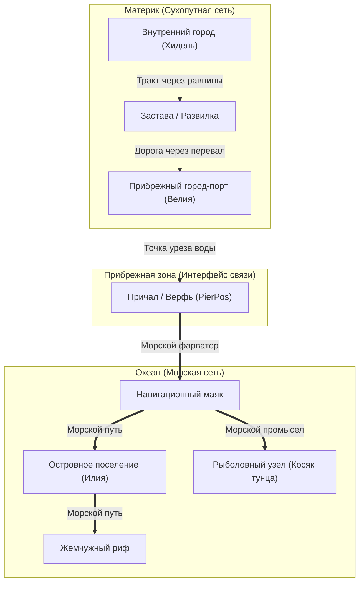

# Генерация дорог, морских путей и прибрежных узлов (Artisan's Delight)

> **Статус документа:** Архитектурная концепция и технический дизайн  
> **Версия движка:** Minecraft 1.20.1+ (Noise-based ChunkGenerator / Caves & Cliffs generation)  
> **Связанные модули:** `WorldObjectManager`, `ChunkGenerator`, `TestMap` (BDO World Map)

---

## 1. Общая философия и цели системы

Традиционные моды либо связывают поселения условными «прямыми линиями», проходящими насквозь через горы и океаны, либо требуют предварительной генерации сотен тысяч блоков мира, что намертво подвешивает сервер.

В **Artisan's Delight** логистическая сеть строится на трёх принципах:
1. **Нулевая нагрузка на мир (Zero-Chunk-Loading Generation):** Все высоты, океаны, реки и биомы сэмплируются напрямую из математических формул ванильного генератора без загрузки или создания чанков.
2. **Органичный рельеф (Organic Terrain-Aware Roads):** Сухопутные дороги прокладываются по долинам, пологим склонам и естественным перевалам, огибая скалы и водоёмы.
3. **Единая мультимодальная сеть (Суша + Море):** Поселения на побережье автоматически признаются **портами**, объединяя сеть сухопутных трактов и морских торговых путей без необходимости в неуклюжих «пересадочных узлах».



---

## 2. Математическое сэмплирование ванильного генератора без загрузки чанков

Начиная с версии 1.18, генератор мира (`NoiseBasedChunkGenerator`) стал полностью функциональным. Мы можем узнать состояние любой точки мира за микросекунды.

### 2.1. Определение высоты поверхности и глубины океана
```java
// Высота поверхности суши (или уровень моря Y=63 над водой)
int surfaceY = chunkGenerator.getBaseHeight(
    x, z, 
    Heightmap.Types.WORLD_SURFACE_WG, 
    levelHeightAccessor, 
    randomState
);

// Высота дна (грунта под водой)
int oceanFloorY = chunkGenerator.getBaseHeight(
    x, z, 
    Heightmap.Types.OCEAN_FLOOR_WG, 
    levelHeightAccessor, 
    randomState
);
```

* **Суша:** `surfaceY > 63` (при этом `surfaceY == oceanFloorY`).
* **Водоём (море/река):** `surfaceY == 63`, а `oceanFloorY < 63`.
* **Глубина воды:** `depth = 63 - oceanFloorY`. Если `depth > 6` блоков — это глубокий судоходный океан; если `depth <= 3` — мелководье/брод.

### 2.2. Определение биомов без чанков
```java
Holder<Biome> biome = chunkGenerator.getBiomeSource().getNoiseBiome(
    QuartPos.fromBlock(x), 
    QuartPos.fromBlock(surfaceY), 
    QuartPos.fromBlock(z), 
    randomState.sampler()
);
```
Позволяет мгновенно проверить теги биомов (`BiomeTags.IS_OCEAN`, `BiomeTags.IS_RIVER`, `BiomeTags.IS_MOUNTAIN`).

### 2.3. Шумовой роутер континентальности (Поиск побережий)
Шум `continentalness` (`randomState.router().continents()`) отвечает за распределение суши и океана:
* `< -0.15` — глубокий открытый океан.
* `[-0.05 ... +0.05]` — **береговая линия (урез океана)**.
* `> +0.05` — суша (континент).

---

## 3. Алгоритм прокладки сухопутных дорог (Coarse A* Pathfinding)

Для поиска дорог между городами на расстояниях в 1000–3000 блоков используется **грубая сетка (Coarse Grid)** с шагом узлов $\Delta = 16$ или $32$ блока (1–2 чанка).

### 3.1. Формула стоимости перехода ($Cost$)
$$\text{Cost}(A \to B) = \text{EuclideanDistance}(A, B) \times \text{TerrainMultiplier}$$

```java
public double evaluateLandCost(ChunkGenerator gen, LevelHeightAccessor h, RandomState state, 
                              BlockPos from, BlockPos to) {
    int fromY = gen.getBaseHeight(from.getX(), from.getZ(), Heightmap.Types.WORLD_SURFACE_WG, h, state);
    int toY = gen.getBaseHeight(to.getX(), to.getZ(), Heightmap.Types.WORLD_SURFACE_WG, h, state);
    int floorY = gen.getBaseHeight(to.getX(), to.getZ(), Heightmap.Types.OCEAN_FLOOR_WG, h, state);

    double distance = Math.sqrt(from.distSqr(to));
    double multiplier = 1.0;

    // 1. Препятствие: вода
    boolean isWater = toY <= 63 && floorY < 63;
    if (isWater) {
        int depth = 63 - floorY;
        if (depth > 5) {
            return Double.POSITIVE_INFINITY; // Глубокое море непроходимо для дороги
        } else {
            multiplier += 6.0; // Река: проходимо, но штрафуется (поиск узкого места под мост)
        }
    }

    // 2. Препятствие: крутизна склона (Slope Penalty)
    int deltaY = Math.abs(toY - fromY);
    if (deltaY > 1) {
        multiplier += Math.pow(deltaY, 1.9) * 0.45; // Экспоненциальный штраф за скалы
    }

    // 3. Препятствие: пики гор
    if (toY > 105) {
        multiplier += (toY - 105) * 0.25;
    }

    return distance * multiplier;
}
```

### 3.2. Почему это работает:
* **Обход заливов:** Дорога никогда не пойдет по дну глубокого океана и автоматически обогнет берег.
* **Перевалы:** Подниматься прямо на пик горы ($\Delta Y = 30$) алгоритму обходится в сотни раз «дороже», чем пройти по пологой лощине или седловине между холмами.

---

## 4. Концепция прибрежного поселения: «Город = Порт»

Вместо отдельных узлов-причалов, каждый город, сгенерированный вблизи океана, **автоматически распознаётся как город-порт**.

### 4.1. Детектор побережья (Radial Shoreline Probe)
При регистрации поселения запускается сканирование по 16 радиальным направлениям в радиусе 80 блоков от ратуши:

```java
public static class PortDetectionResult {
    public final boolean isPortTown;
    public final BlockPos pierPos; // Координата стыка суши и воды для причала

    public PortDetectionResult(boolean isPortTown, BlockPos pierPos) {
        this.isPortTown = isPortTown;
        this.pierPos = pierPos;
    }
}

public static PortDetectionResult detectCoastalTown(ChunkGenerator gen, LevelHeightAccessor h, 
                                                    RandomState state, BlockPos townCenter) {
    int scanRadius = 80;
    int samples = 16;
    BlockPos bestPier = null;
    int maxOceanDepth = 0;

    for (int i = 0; i < samples; i++) {
        double angle = 2.0 * Math.PI * i / samples;
        int checkX = townCenter.getX() + (int) (Math.cos(angle) * scanRadius);
        int checkZ = townCenter.getZ() + (int) (Math.sin(angle) * scanRadius);

        int surfY = gen.getBaseHeight(checkX, checkZ, Heightmap.Types.WORLD_SURFACE_WG, h, state);
        int floorY = gen.getBaseHeight(checkX, checkZ, Heightmap.Types.OCEAN_FLOOR_WG, h, state);

        if (surfY <= 63 && floorY < 57) { // Найдена глубокая морская вода
            int depth = 63 - floorY;
            if (depth > maxOceanDepth) {
                maxOceanDepth = depth;
                bestPier = traceShoreline(gen, h, state, townCenter, checkX, checkZ);
            }
        }
    }

    return bestPier != null 
        ? new PortDetectionResult(true, bestPier) 
        : new PortDetectionResult(false, null);
}

// Бинарный поиск точки уреза воды (Y=63) между центром города и морем
private static BlockPos traceShoreline(ChunkGenerator gen, LevelHeightAccessor h, RandomState state, 
                                      BlockPos center, int targetX, int targetZ) {
    double low = 0.0, high = 1.0;
    int resX = targetX, resZ = targetZ;

    for (int i = 0; i < 6; i++) {
        double mid = (low + high) * 0.5;
        int curX = (int) (center.getX() + (targetX - center.getX()) * mid);
        int curZ = (int) (center.getZ() + (targetZ - center.getZ()) * mid);
        int y = gen.getBaseHeight(curX, curZ, Heightmap.Types.WORLD_SURFACE_WG, h, state);

        if (y > 63) {
            low = mid;
        } else {
            high = mid;
            resX = curX;
            resZ = curZ;
        }
    }
    return new BlockPos(resX, 63, resZ);
}
```

### 4.2. Гарантированный спавн прибрежных деревень
Чтобы гарантировать появление морских городов в островных мирах:
1. **Поиск по изоклине шума:** Перед спавном структуры ищем координаты с `continentalness` в диапазоне $[-0.04 \dots +0.04]$. Это точка берега.
2. **Включение пляжей в структуру:** В ванильном `StructureSet` деревень разрешается спавн в биомах `#minecraft:is_beach` и `minecraft:stony_shore`.

---

## 5. Морские узлы и морской поиск пути (Sea Pathfinding)

Морские пути работают по **инвертированным правилам**: вода — открытая автострада, а суша — непреодолимая стена.

### 5.1. Типы морских узлов
* **`PORT` (Пристань города):** Точка старта морских торговых караванов и рыбаков.
* **`ISLAND_TOWN` (Островная деревня):** Изолированный город на острове, доступный только по воде.
* **`FISHERY` (Рыболовный промысел):** Глубоководные промысловые зоны (косяки рыбы, китобойный промысел).
* **`PEARL_REEF` (Жемчужный риф):** Добыча жемчуга, кораллов и водорослей в теплых океанах.
* **`LIGHTHOUSE` (Навигационный маяк):** Опорный пункт посреди океана для продления торгового пути.

### 5.2. Функция стоимости морского шага
```java
public double evaluateSeaCost(ChunkGenerator gen, LevelHeightAccessor h, RandomState state, BlockPos target) {
    int surfY = gen.getBaseHeight(target.getX(), target.getZ(), Heightmap.Types.WORLD_SURFACE_WG, h, state);
    int floorY = gen.getBaseHeight(target.getX(), target.getZ(), Heightmap.Types.OCEAN_FLOOR_WG, h, state);

    // 1. Суша (острова, берега) — корабль врежется!
    if (surfY > 63) {
        return Double.POSITIVE_INFINITY;
    }

    int depth = 63 - floorY;

    // 2. Мели и рифы
    if (depth < 3) return 80.0;  // Опасно сесть на мель
    if (depth < 6) return 3.0;   // Мелководье у берега

    // 3. Открытый глубокий океан
    return 1.0;
}
```

---

## 6. Промежуточные узлы вдоль дорог

Когда маршрут между городами построен в виде списка опорных точек (`waypoints`):

```
[Город А] ─── (300 блоков) ─── [Застава / Пост] ─── (350 блоков) ─── [Город Б]
                                      │
                                      └─── [Лесопилка / Шахта] (Ответвление 80 блоков)
```

1. **Дорожные заставы (`WAYPOINT` / `OUTPOST`):**
   * Размещаются каждые **300–450 блоков** пути.
   * Обязательно ставятся на **пересечениях дорог** (развилках) и перед сложными мостами/перевалами.
2. **Производственные узлы (`PRODUCTION`):**
   * Ищутся в радиусе 60–100 блоков от ключевых точек дороги.
   * Тип узла определяется преобладающим биомом:
     * Лес / Тайга $\to$ **Лесопилка** (добыча брёвен, коры, живицы).
     * Скалы / Горы $\to$ **Рудник / Каменоломня** (железо, уголь, сланец).
     * Равнина $\to$ **Ферма / Плантация** (пшеница, лен, овощи).

---

## 7. Модель данных в ECS (`WorldObject`)

Каждое поселение и узел оснащаются компонентами:

```java
// Компактная 2D точка маршрута (без координаты Y)
public record RoadPoint2D(int x, int z) {
    public static long pack(int x, int z) {
        return ((long) x << 32) | (z & 0xFFFFFFFFL);
    }
    public static RoadPoint2D unpack(long packed) {
        return new RoadPoint2D((int) (packed >> 32), (int) packed);
    }
}

// Маркер порта для прибрежных городов
public class TownPortComponent implements Component {
    public final BlockPos wharfPos;        // Координаты причала у кромки воды (на суше у воды)
    public final List<UUID> seaConnections; // Связанные морские узлы / острова
    public int shipsCapacity = 2;          // Лимит судов
}

// Связь дорожного ребра в графе
public class RouteConnectionComponent implements Component {
    public enum RouteType { LAND_ROAD, SEA_LANE }
    
    public final UUID targetNodeId;
    public final RouteType routeType;
    public final List<RoadPoint2D> waypoints; // Ломаная линия дороги/фарватера (только X, Z!)
    public final double totalDistance;
}
```

> **Почему только X и Z без координаты Y?**
> 1. **Нулевая избыточность для карты:** Рендерер 2D-карты использует только `worldToRootX(x)` и `worldToRootY(z)`. Высота $Y$ в UI не нужна.
> 2. **Экономия памяти и сети:** Экономит 33% размера пакетов при сетевой синхронизации между сервером и клиентом.
> 3. **Мир знает свою высоту сам:** При физической декорации чанка на сервере актуальный $Y$ берется напрямую из чанка (`chunk.getHeight(Heightmap.Types.WORLD_SURFACE, x & 15, z & 15)`), поэтому хранить его в графе не требуется.

---

## 8. Материализация дорог в физическом мире

Дорога существует в виде вектора в памяти, а блоки в мире появляются **лениво** при естественной генерации чанка игроком.

В миксине декорации чанков (`ChunkGenerator.applyBiomeDecoration`):
1. Проверяем, пересекают ли отрезки дорог координаты текущего чанка $(cx, cz)$.
2. Если отрезок проходит через чанк:
   * Находим блоки поверхности на ширину 3 блока от осевой линии.
   * Заменяем верхний слой дерна на `Blocks.DIRT_PATH`, `Blocks.GRAVEL`, `Blocks.COBBLESTONE` со случайным шумом износа.
   * При пересечении рек строятся деревянные мостки (`Blocks.OAK_PLANKS`, `Blocks.OAK_FENCE`) на уровне $Y=64$.

---

## 9. Визуализация на карте мира (BDO World Map): Два режима отображения

На карте поддерживается **два режима отображения связей**:

### 9.1. Режим 1: Логическая сеть узлов (Node Network Mode — по умолчанию)
* Классический режим в стиле Black Desert Online.
* Узлы связываются **прямой линией от узла к узлу** `(posA -> posB)`.
* Четко визуализирует иерархию инвестиций Очков Влияния (CP):
  * **Активная связь (узлы инвестированы):** Толстая сияющая янтарная линия (`#FFD559`).
  * **Неактивная связь:** Тонкая матовая сине-серая линия (`#6684AD`).
  * **Псевдо-связи планирования:** Пунктирные линии с маркером на середине.

### 9.2. Режим 2: Режим реальных путей и дорог (Roads & Paths Mode)
* Переключается отдельной кнопкой в верхней панели карты (рядом с фильтром узлов).
* Отрисовывает **реальную криволинейную траекторию** дороги/фарватера по цепочке 2D-точек `(x_i, z_i) -> (x_{i+1}, z_{i+1})`:
  * **Сухопутные тракты:** Сплошная линия цвета проселочной дороги / брусчатки, огибающая горы и ущелья по долинам.
  * **Морские фарватеры:** Пунктирная лазурно-синяя дуговая линия по глубокой воде между портами и маяками.
  * **Цветовая индикация инвестиций:** Если путь соединен и инвестирован — дорога подсвечивается золотым ореолом караванного маршрута.

### 9.3. Иконки и обозначения
* Обычный город: `🏰`
* Прибрежный город-порт: `⚓` (с кнопкой **«Пристань»** в меню поселения)
* Морские промыслы: `🐟` (Рыба), `🦪` (Жемчуг), `🗼` (Маяк)

